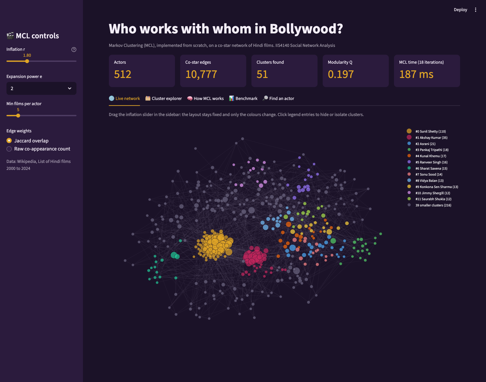
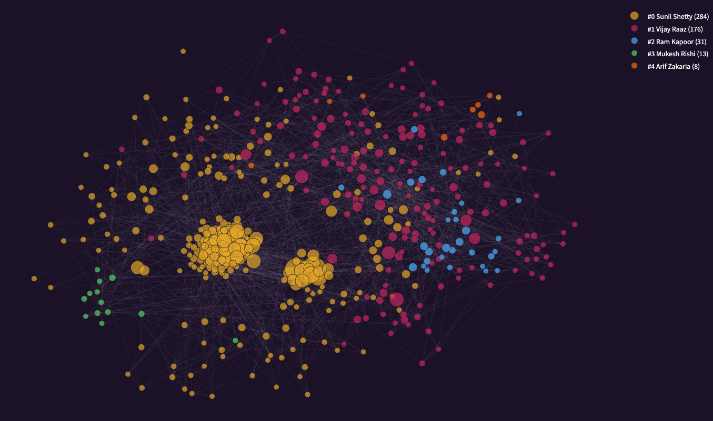
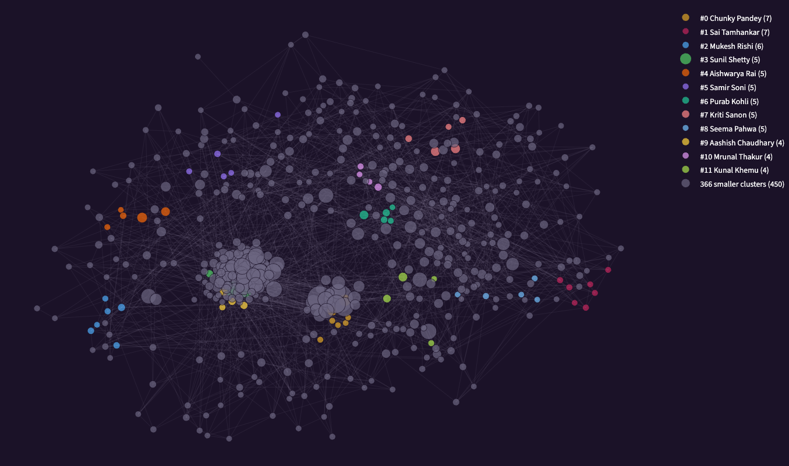
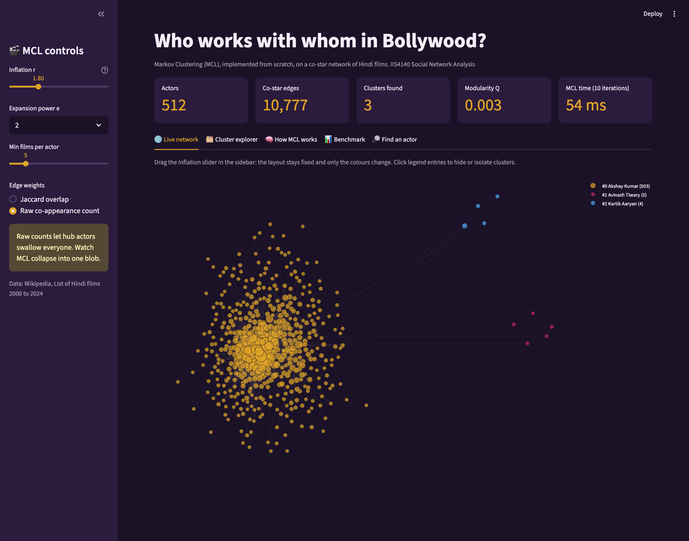
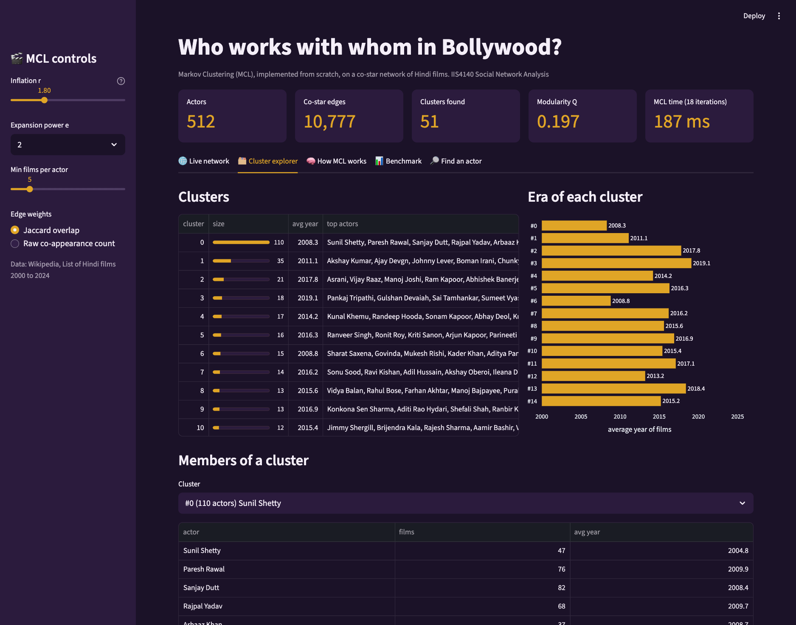
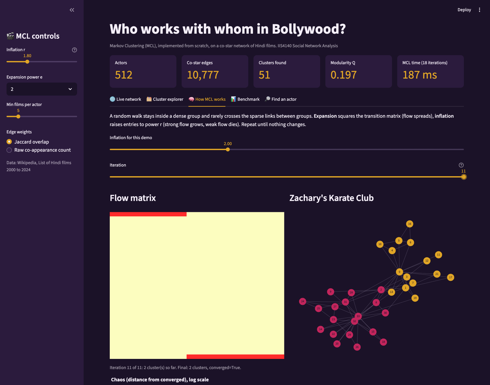
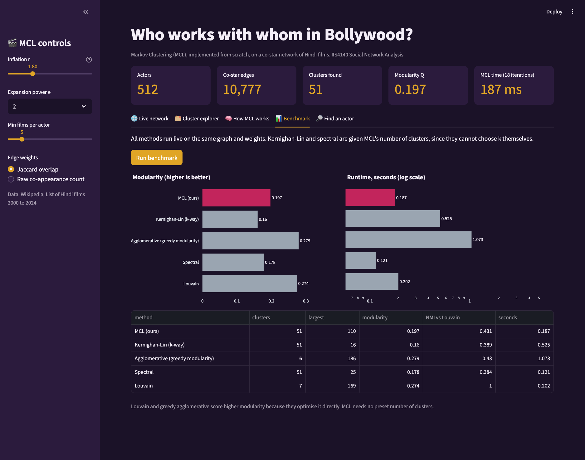
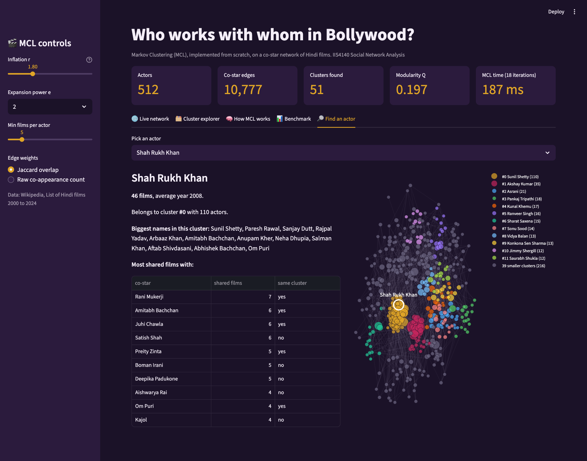

# Who works with whom in Bollywood? Markov Clustering on a co-star network

Can an algorithm find the "friend groups" of Hindi cinema using nothing but casts? This project builds a **co-star network of 512 actors from 2,305 Hindi films (2000 to 2024)**, then finds its communities with **Markov Clustering (MCL), implemented from scratch in NumPy**. MCL is benchmarked against Kernighan-Lin, agglomerative, spectral and Louvain clustering, and explored through an interactive **Streamlit** app.

Mini project for *IIS4140 Social Network Analysis*, Manipal University Jaipur.



## Headline results

- MCL found **51 communities** in about 0.1 seconds without being told how many to look for.
- The communities line up with **eras and styles of cinema**, even though MCL never saw a year. Examples: the recent OTT and indie cast around Pankaj Tripathi (avg. film year 2019), the young stars Ranveer Singh, Alia Bhatt and Arjun Kapoor (2016), and the 90s-style veterans Govinda and Kader Khan (2009).
- **Edge weighting decides everything.** On raw co-appearance counts MCL puts 503 of 512 actors in one blob. Weighting by Jaccard overlap fixes it.
- MCL beats Kernighan-Lin and spectral clustering at the same number of clusters. It scores **below** Louvain and greedy agglomerative clustering on modularity, because those optimise modularity directly.

## The app

```bash
.venv/bin/streamlit run app.py        # then open http://localhost:8501
```

The first load takes about 15 seconds while the layout is computed. After that it is cached.

### Live network with an inflation slider

The inflation parameter `r` controls how fine the clusters are. The layout stays fixed and only the colours change as you drag the slider.

| r = 1.4 (5 clusters, Q 0.210) | r = 2.6 (378 clusters, Q 0.045) |
|---|---|
|  |  |

### Why edge weights matter

Switch the sidebar to raw co-appearance counts and MCL collapses. Prolific hub actors dominate the random walk and pull everyone into one cluster.



### Cluster explorer

Every cluster with its size, average film year and top actors, plus an era chart and a member list.



### How MCL works, step by step

Step through the iterations on Zachary's Karate Club. The flow matrix collapses onto a few "attractor" rows, and those rows are the clusters. Our implementation recovers the 2 known factions.



### Live benchmark

One button runs MCL, Kernighan-Lin, agglomerative, spectral and Louvain on the same graph.



### Find an actor

Pick any actor to see their cluster, their closest co-stars and where they sit in the network.



## How MCL works

A random walk on a graph stays inside a dense group for a long time and only rarely crosses the sparse links between groups. MCL exploits this:

1. Add self-loops and column-normalise the adjacency matrix into a transition matrix `M`.
2. **Expansion:** `M <- M^2`. Flow spreads along longer walks.
3. **Inflation:** raise every entry to the power `r` and re-normalise. Strong flow gets stronger, weak flow dies.
4. Prune tiny entries and repeat until the matrix stops changing (van Dongen's *chaos* measure reaches 0).
5. Rows that keep flow are *attractors*. Each node joins the cluster of the attractor it flows to.

The implementation is in [mcl.py](mcl.py), about 90 lines.

## Data and method

| | |
|---|---|
| Source | Cast tables on Wikipedia's *List of Hindi films of YEAR*, 2000 to 2024 |
| Films | 2,305 films with at least 2 linked cast members |
| Nodes | 512 actors with at least 5 films |
| Edges | 10,777 co-star pairs (two actors who share a film) |
| Edge weight | Jaccard overlap: shared films / (films of A + films of B - shared films) |

## Benchmark

All methods run on the same graph with the same weights. Kernighan-Lin and spectral were given MCL's number of clusters, since they cannot choose it themselves.

| Method | Clusters | Modularity | Needs k? |
|---|---|---|---|
| **MCL, r = 1.8** | 51 | 0.197 | no |
| **MCL, r = 1.4** | 5 | 0.210 | no |
| Kernighan-Lin (recursive) | 51 | 0.161 | yes |
| Spectral | 51 | 0.178 | yes |
| Agglomerative (greedy modularity) | 6 | 0.279 | no |
| Louvain | 7 | 0.274 | no |

Modularity falls when a graph is split into many small clusters, so the 51-cluster rows are not directly comparable with the 6 and 7-cluster rows.

## Example clusters (r = 1.8)

The labels are my interpretation of each cluster's top actors, not algorithm output.

| Size | Avg. year | Key actors | Reading |
|---|---|---|---|
| 110 | 2008 | Sunil Shetty, Paresh Rawal, Sanjay Dutt | Ensemble veterans |
| 35 | 2011 | Akshay Kumar, Ajay Devgn, Johnny Lever | Comedy and action ensembles |
| 18 | 2019 | Pankaj Tripathi, Gulshan Devaiah, Sumeet Vyas | Recent OTT and indie wave |
| 16 | 2016 | Ranveer Singh, Alia Bhatt, Arjun Kapoor | Young stars |
| 15 | 2009 | Govinda, Kader Khan, Sharat Saxena | 90s-style veterans |
| 11 | 2015 | Radhika Apte, Richa Chadha, Nawazuddin Siddiqui | Actor-driven indie cinema |

## Repository layout

```
app.py               Streamlit demo
mcl.py               Markov Clustering from scratch
analysis.py          graph building, benchmark, inflation sweep, weight ablation
make_figures.py      static figures for the report and slides
scrape_cast.py       downloads the casts from Wikipedia
validate_karate.py   checks MCL against the Karate Club factions
data/films.csv       scraped films and casts
outputs/             result tables and figures
docs/                full report, slide outline, slide deck, screenshots
```

## Run it yourself

```bash
python3 -m venv .venv && .venv/bin/pip install -r requirements.txt
```

```bash
.venv/bin/streamlit run app.py          # interactive demo
.venv/bin/python validate_karate.py     # MCL sanity check
.venv/bin/python analysis.py            # tables in outputs/
.venv/bin/python make_figures.py        # figures in outputs/
.venv/bin/python scrape_cast.py         # optional: re-download the data
```

Tested with Python 3.9.

## Limitations

- Wikipedia cast lists are partial (mostly top-billed actors), and only linked actor names are captured.
- Only Hindi films from 2000 to 2024, and only actors with at least 5 films.
- MCL produces hard clusters, but real actors move between circles.
- The inflation parameter was chosen using modularity and readability. There is no ground-truth labelling for this network.

## More

- Full write-up: [docs/REPORT.md](docs/REPORT.md)
- Slides: [docs/bollywood_mcl_presentation.pptx](docs/bollywood_mcl_presentation.pptx), outline in [docs/PRESENTATION.md](docs/PRESENTATION.md)

## References and credits

- S. van Dongen, *Graph Clustering by Flow Simulation*, PhD thesis, University of Utrecht, 2000.
- Film and cast data from Wikipedia, *List of Hindi films of YEAR*, licensed under [CC BY-SA 4.0](https://creativecommons.org/licenses/by-sa/4.0/).
