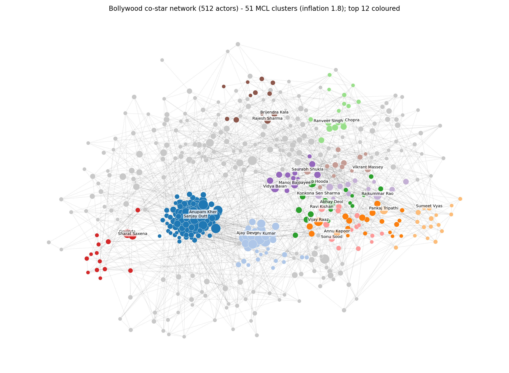
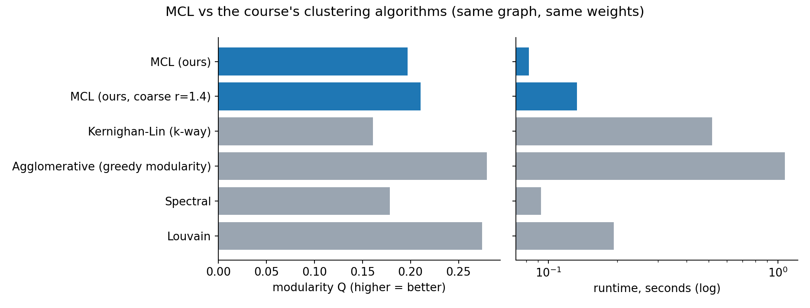

# Markov Clustering on the Bollywood Co-Star Network

**Course:** IIS4140 Social Network Analysis, Manipal University Jaipur
**Topic:** Markov Clustering (MCL), CO4 (examine and apply techniques to solve problems)

## 1. Problem

Who forms the "friend groups" of Hindi cinema? Actors are linked when they appear in the same film, and a community here is a set of actors who keep working together. We use **Markov Clustering (MCL)** to discover these communities without telling the algorithm how many there are.

## 2. Data

Built from scratch (`scrape_cast.py`): the cast tables on Wikipedia's *List of Hindi films of YEAR* pages, 2000 to 2024.

| Quantity | Value |
|---|---|
| Films with at least 2 linked cast members | 2,305 |
| Distinct actors | 2,060 |
| Actors kept (at least 5 films) | 512 |
| Co-star edges (shared at least 1 film) | 10,777 |

- **Nodes:** actors with at least 5 films, which removes one-off cameos.
- **Edges:** two actors share a film.
- **Edge weight:** Jaccard overlap, `shared films / (films of A + films of B - shared films)`. See section 5 for why.

## 3. Method: MCL, implemented from scratch (`mcl.py`)

MCL simulates random-walk flow on the graph.

1. Add self-loops and column-normalise the adjacency matrix into a transition matrix `M`.
2. **Expansion:** `M <- M^2` (flow spreads along longer walks).
3. **Inflation:** `M <- M .^ r` then re-normalise (strong flow gets stronger, weak flow dies).
4. Prune tiny entries, and repeat until the matrix stops changing (van Dongen's *chaos* measure goes to 0).
5. Rows that keep flow are *attractors*, and each node joins the cluster of the attractor it flows to.

Why it works: a random walk stays inside a dense group for a long time and rarely crosses the sparse links between groups, so inflation cuts those links.

**Validation:** on Zachary's Karate Club, our implementation finds the 2 factions at r = 2.0 (NMI 0.73, modularity 0.348, converged in 11 iterations) (`validate_karate.py`).

## 4. Results (r = 1.8)

MCL finds **51 clusters** in 18 iterations (0.08 s). The largest are below. The labels are my interpretation of the top actors, not output of the algorithm.

| # | Size | Avg. film year | Representative actors | Reading |
|---|---|---|---|---|
| 0 | 110 | 2008 | Sunil Shetty, Paresh Rawal, Sanjay Dutt, Anupam Kher | Large pool of 2000s-era commercial ensemble and character actors |
| 1 | 35 | 2011 | Akshay Kumar, Ajay Devgn, Johnny Lever, Boman Irani | Comedy and action ensemble films |
| 2 | 21 | 2018 | Vijay Raaz, Manoj Joshi, Gajraj Rao, Abhishek Banerjee | Recent character-actor circle |
| 3 | 18 | 2019 | Pankaj Tripathi, Gulshan Devaiah, Sumeet Vyas | Recent indie and OTT-era cast |
| 5 | 16 | 2016 | Ranveer Singh, Kriti Sanon, Arjun Kapoor, Alia Bhatt | Mid-2010s young-star films |
| 6 | 15 | 2009 | Govinda, Kader Khan, Sharat Saxena, Aditya Pancholi | 90s-style masala-film veterans |
| 14 | 11 | 2015 | Radhika Apte, Richa Chadha, Nawazuddin Siddiqui | Actor-driven indie cinema |

**Main finding:** with no information about time, the clusters line up with **eras and styles of cinema**. Across all 51 clusters the average film year runs from about 2005 to 2021 (`fig_eras.png` shows the 8 largest), and in the layout (`fig_network.png`) older casts sit on the left and recent ones on the right.



## 5. Benchmark against the course's algorithms

All methods run on the same graph with the same Jaccard weights (`outputs/benchmark.csv`).

| Method | Clusters | Modularity | Time (s) |
|---|---|---|---|
| **MCL, r = 1.8** | 51 | 0.197 | 0.08 |
| **MCL, r = 1.4 (coarse)** | 5 | 0.210 | 0.13 |
| Kernighan-Lin (recursive, k = 51) | 51 | 0.161 | 0.52 |
| Spectral (k = 51) | 51 | 0.178 | 0.09 |
| Agglomerative (greedy modularity) | 6 | 0.279 | 1.08 |
| Louvain | 7 | 0.274 | 0.19 |

Honest reading:
- MCL **beats Kernighan-Lin and spectral at the same number of clusters** and is among the fastest.
- MCL's modularity is **lower than Louvain and greedy-modularity agglomerative clustering**. That is expected, because those methods optimise modularity directly and MCL does not.
- MCL's advantage is that it **needs no preset number of clusters**. Kernighan-Lin and spectral had to be told k, and we gave them MCL's k.
- Modularity falls when a graph is split into many small clusters, so the 51-cluster rows are not directly comparable with the 6-cluster rows.



## 6. Two findings about MCL itself

**a) The inflation parameter controls granularity** (`fig_inflation_sweep.png`, `outputs/inflation_sweep.csv`). Low r (at most 1.3) leaves everything in one cluster. r = 1.4 gives 5 clusters, r = 1.8 gives 51, and r at least 2.5 shatters the graph into mostly singletons. Modularity is best at about r = 1.4 to 1.8.

**b) MCL is very sensitive to edge weights** (`outputs/weight_ablation.csv`). On raw co-appearance counts, hub actors with 70+ films dominate the flow:

| Weights | r | Clusters | Largest cluster | Modularity |
|---|---|---|---|---|
| raw counts | 1.8 | 3 | 503 of 512 | 0.003 |
| raw counts | 2.0 | 6 | 489 of 512 | 0.010 |
| Jaccard | 1.8 | 51 | 110 | 0.197 |

Normalising by each actor's film count fixes this. It is a general lesson: MCL needs a similarity measure, not just a count.

## 7. Limitations

- Wikipedia cast lists are partial (usually the top-billed actors), and only linked actor names are captured.
- Only Hindi films from 2000 to 2024, and only actors with at least 5 films.
- MCL gives **hard** clusters, but real actors move between circles (overlapping communities).
- The inflation parameter was chosen using modularity and readability, so it is a judgement call. There is no ground-truth labelling for this network.
- The cluster labels in section 4 are my reading of the top actors, not verified facts.

## 8. Conclusion

MCL is a fast, simple community-detection method that needs no preset cluster count and found sensible era and style groups in the Bollywood co-star network. Its weak spots are sensitivity to edge weights and to the inflation parameter, and it scores below modularity-optimising methods on modularity.

## 9. Reproduce

```bash
python3 -m venv .venv && .venv/bin/pip install -r requirements.txt
.venv/bin/python scrape_cast.py      # downloads casts (cached in data/raw)
.venv/bin/python validate_karate.py  # MCL sanity check
.venv/bin/python analysis.py         # tables in outputs/
.venv/bin/python make_figures.py     # figures in outputs/
```

## References

- S. van Dongen, *Graph Clustering by Flow Simulation*, PhD thesis, 2000.
- Course handout IIS4140, Lectures 26 to 27 (Markov Clustering) and 15 to 23 (community discovery, KL, agglomerative, spectral).
- Data: Wikipedia, *List of Hindi films of YEAR* (CC BY-SA).
